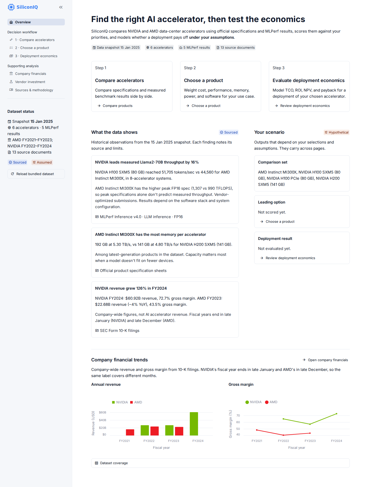
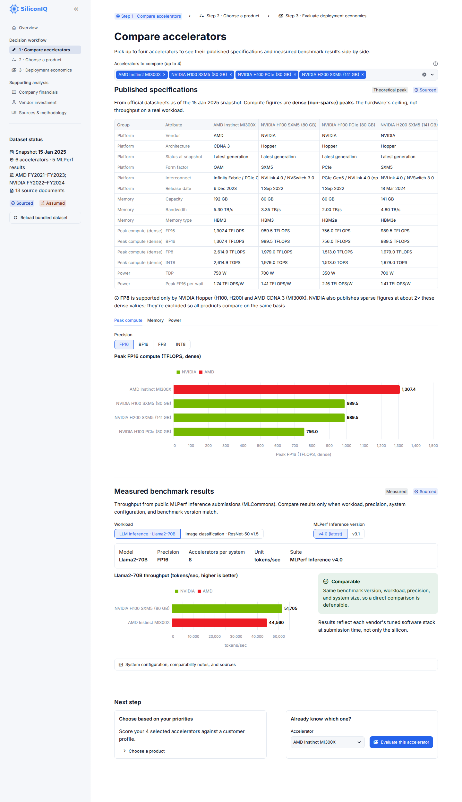
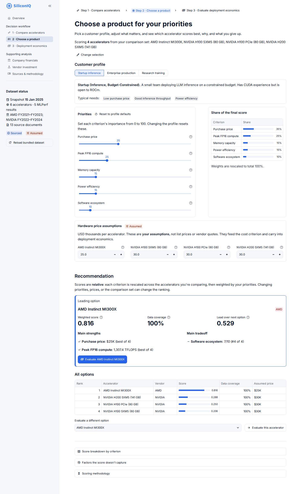
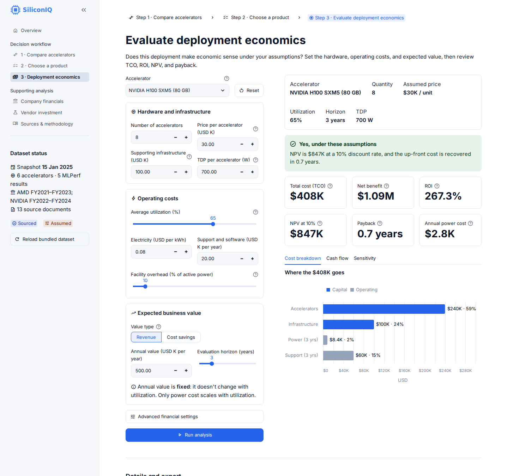
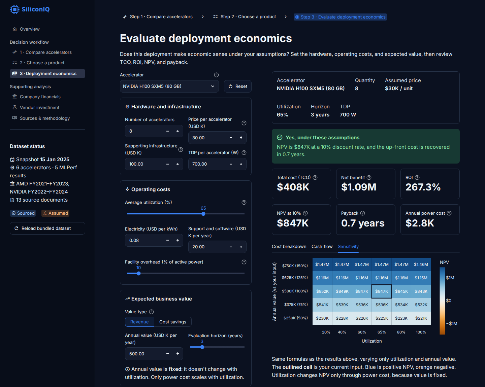

# SiliconIQ

**Compare AI accelerators, choose one for your priorities, and test whether a deployment pays off.**

SiliconIQ is a Streamlit analytics app that combines SEC 10-K financials, official
accelerator spec sheets, and MLPerf benchmark results for NVIDIA and AMD data-center
GPUs. It guides you through a three-step decision workflow and labels every number as
**sourced** (from a filing, datasheet, or benchmark) or **assumed** (entered by you).



---

## Why it exists

Picking a data-center accelerator mixes three kinds of information that are easy to misuse:

- **Peak specs** (TFLOPS, memory) that don't predict real throughput on their own
- **Benchmarks** that are only comparable when workload, precision, and system size match
- **Economics** that depend on prices, utilization, and business value no vendor publishes

SiliconIQ puts them in one place and keeps the line between fact and assumption visible.

> **Example finding.** On MLPerf Inference v4.0 Llama2-70B (FP16, 8-GPU systems), the
> NVIDIA H100 SXM5 delivered **51,705 tokens/s vs 44,560 for the AMD Instinct MI300X
> (+16%)**, even though the MI300X has the higher peak FP16 spec (1,307 vs 990 TFLOPS).
> Peak specifications alone don't predict measured throughput.

---

## Features

### Decision workflow

| Step | What you do | What you get |
|---|---|---|
| **1 · Compare accelerators** | Pick up to four GPUs | Grouped spec table, aligned charts, and a separate measured-benchmark section with comparability status |
| **2 · Choose a product** | Pick a customer profile, weight five priorities, set price assumptions | A leading option with score, data coverage, strengths, tradeoff, and close-call warnings |
| **3 · Deployment economics** | Enter hardware, operating costs, and expected value | A plain-language verdict plus TCO, ROI, NPV, payback, cash flow, and NPV sensitivity |

Selections carry between steps. Inputs persist for the whole session.

### Supporting analysis

- **Company financials:** revenue, growth, margins, R&D, and segments from 10-K filings
- **Vendor investment (hypothetical):** downside / base / upside scenarios with price × demand sensitivity
- **Sources & methodology:** every source document, comparability rules, and formulas

### Also

- Light and dark themes; responsive down to phone width
- One-click Excel export of the dataset and every analysis you ran in the session
- Reload the bundled dataset from the sidebar

<table>
  <tr>
    <td></td>
    <td></td>
  </tr>
  <tr>
    <td align="center">Compare accelerators</td>
    <td align="center">Choose a product</td>
  </tr>
  <tr>
    <td></td>
    <td></td>
  </tr>
  <tr>
    <td align="center">Deployment economics</td>
    <td align="center">NPV sensitivity (dark mode)</td>
  </tr>
</table>

---

## Quick start

Requires **Python 3.11+**.

```bash
git clone <this-repo-url>
cd siliconIQ
pip install -r requirements.txt
streamlit run app.py
```

The app opens at http://localhost:8501. On first run it builds `data/siliconiq.db`
from the bundled dataset automatically.

### Run the tests

```bash
pip install -r requirements-dev.txt
python -m pytest tests/ -v
```

Expected: **77 passed**.

### Commands

| Purpose | Command |
|---|---|
| Launch the app | `streamlit run app.py` |
| Rebuild the database manually | `python -m siliconiq.ingest` |
| Force a full re-seed | `python -m siliconiq.ingest --force` |
| Run tests | `python -m pytest tests/ -v` |

---

## How it's built

| Layer | Tools |
|---|---|
| App | Python, Streamlit (multipage navigation, forms, session-persisted inputs) |
| Charts | Altair / Vega-Lite, theme-aware in light and dark mode |
| Data | SQLite with views, pandas query layer |
| Export | openpyxl |
| Tests | pytest |

All math lives in pure modules with no Streamlit dependency, so every formula and the
way each page wires inputs into it are unit-tested independently of the UI.

```
app.py                  Entrypoint: page config, session defaults, navigation
app_pages/              One script per page
  overview.py             Landing page: entry points, sourced findings, your scenario
  compare.py              Step 1: specs vs measured MLPerf results
  strategy.py             Step 2: profile, priorities, prices, recommendation
  deployment.py           Step 3: TCO, ROI, NPV, payback
  financials.py           Company financials
  vendor.py               Hypothetical vendor investment
  sources.py              Sources & methodology
siliconiq/
  calculations.py         Pure formulas: margins, NPV, IRR, payback, ROI, TCO, scoring
  analysis.py             Scenario wiring and derived findings (pure)
  formatting.py           Currency, percent, and unavailable-value formatting (pure)
  ui.py                   Shared UI: cached data, headers, step indicator, charts
  queries.py              SQL queries returning DataFrames
  ingest.py               Bundled dataset and idempotent ingestion
  schema.sql, db.py       Schema and connection
  export.py               Excel workbook builder
tests/                  pytest suites for calculations, formatting, and scenario wiring
docs/                   Methodology, product brief, screenshots
.streamlit/config.toml  Light and dark theme
```

---

## Data

| Source type | Documents | Coverage |
|---|---|---|
| SEC 10-K filings | 6 | NVIDIA FY2022–FY2024, AMD FY2021–FY2023 |
| Official spec sheets | 5 | H100 SXM5, H100 PCIe, H200 SXM5, A100 SXM4, MI300X, MI250X |
| MLPerf Inference submissions | 2 | v4.0 and v3.1 (Llama2-70B, ResNet-50) |

**Dataset snapshot:** 15 Jan 2025. "Latest generation" means latest as of that date.

### Important disclaimers

- **No hardware prices are stored.** Every price in the app is a user assumption, not a
  list price or vendor quote.
- Peak compute figures are dense (non-sparse). NVIDIA sparse figures are about 2× higher.
- Data center segment revenue includes more than AI accelerators and is never treated as
  AI accelerator revenue.
- Benchmarks are marked comparable only when version, workload, precision, and system
  configuration match.
- The vendor investment model uses hypothetical inputs only. It doesn't represent
  NVIDIA's or AMD's actual economics.

### Updating the data

1. Download new 10-K filings from SEC EDGAR
2. Update `FINANCIAL_OBSERVATIONS` in `siliconiq/ingest.py`
3. Add products to `PRODUCTS` and MLPerf results to `BENCHMARKS`
4. Run `python -m siliconiq.ingest --force`

Keep each value's `source_id` and `period_id` in sync with its source.

---

## Documentation

- [Methodology](docs/methodology.md): data provenance, comparability rules, scoring and financial models
- [Product brief](docs/product_brief.md): intended users, scope, limitations, roadmap
- [Interview walkthrough](docs/interview_walkthrough.md): design decisions and tradeoffs

---

## License

[MIT](LICENSE) © 2026 cbruce24
